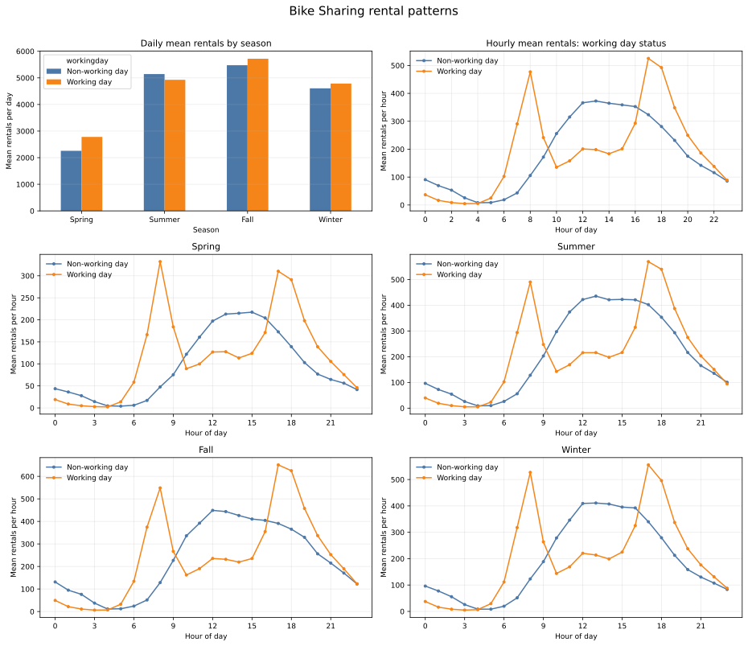

# Bike Sharing 시간별·일별 대여량 분석

문제 번호는 대화에 적혀 있지 않아 저장 경로를 `results/qpt/2-4/`로 가정했다. 자료는 `day.csv`와 `hour.csv`이며, 대여량은 `cnt`로 정의했다. 근무일 변수는 `workingday=1`을 근무일, `workingday=0`을 비근무일로 처리했다. 계절 코드는 1=봄, 2=여름, 3=가을, 4=겨울이다.

## (a) 시간별 합계와 일별 대여량 대조

`dteday`를 `%Y-%m-%d` 형식의 날짜로 변환하고, `hour.csv`의 `cnt`, `casual`, `registered`를 날짜별 합계로 집계해 `day.csv`와 비교했다.

| 확인 항목 | 결과 |
|---|---:|
| 시간별 자료 행 수 | 17,379 |
| 일별 자료 행 수 | 731 |
| 날짜 변환 실패 | 두 자료 모두 0건 |
| 날짜 범위 | 2011-01-01 ~ 2012-12-31 |
| 두 자료에 공통으로 있는 날짜 | 731일 전부 |
| `cnt` 날짜별 합계 일치 | 731일 전부, 차이 0 |
| `casual`, `registered` 합계 일치 | 각각 731일 전부 |
| 전체 `cnt` 합계 | 양쪽 자료 모두 3,292,679건 |

따라서 날짜 형식 변환이나 날짜별 합산 방식으로 인한 불일치는 확인되지 않았다. 다만 시간별 자료가 모든 날짜에 24개 행씩 있는 것은 아니다. 731일 중 655일은 24개 행이고, 76일은 24개 미만이며, 24시간 기준 총 165개 행이 관측되지 않았다. 가장 관측 수가 적은 2012-10-29도 시간별 행은 1개뿐이지만, 그 합계 22건은 일별 자료의 22건과 일치한다. 일별 합계가 일치한다는 사실은 결측 시간 행이 없다는 뜻은 아니다.

## (b) 근무일·비근무일의 시간대별 평균과 변동성

각 시간대에서 관측된 `cnt`의 산술평균과 표본 표준편차(SD)를 계산했다. `n`은 해당 그룹·시간대에서 실제로 기록된 시간별 행 수다. 누락된 시간 행은 0건으로 채우지 않고 제외했다.

| 시간 | 비근무일 n | 비근무일 평균 ± SD | 근무일 n | 근무일 평균 ± SD |
|---:|---:|---:|---:|---:|
| 0 | 230 | 90.8 ± 48.7 | 496 | 36.8 ± 24.5 |
| 1 | 230 | 69.5 ± 36.5 | 494 | 16.6 ± 11.7 |
| 2 | 228 | 53.2 ± 27.9 | 487 | 8.7 ± 6.6 |
| 3 | 227 | 25.8 ± 14.9 | 470 | 4.9 ± 3.4 |
| 4 | 227 | 8.3 ± 5.2 | 470 | 5.4 ± 3.1 |
| 5 | 222 | 8.7 ± 6.7 | 495 | 24.9 ± 12.3 |
| 6 | 229 | 18.7 ± 16.1 | 496 | 102.5 ± 45.8 |
| 7 | 231 | 43.4 ± 37.8 | 496 | 290.6 ± 134.6 |
| 8 | 231 | 105.7 ± 74.3 | 496 | 477.0 ± 186.2 |
| 9 | 231 | 171.6 ± 92.5 | 496 | 241.5 ± 85.7 |
| 10 | 231 | 255.9 ± 127.8 | 496 | 135.4 ± 55.7 |
| 11 | 231 | 315.3 ± 155.3 | 496 | 158.2 ± 69.2 |
| 12 | 231 | 366.3 ± 174.9 | 497 | 200.8 ± 89.3 |
| 13 | 231 | 372.7 ± 178.0 | 498 | 198.4 ± 88.5 |
| 14 | 231 | 364.6 ± 172.3 | 498 | 183.6 ± 87.3 |
| 15 | 231 | 358.8 ± 169.1 | 498 | 201.3 ± 97.6 |
| 16 | 231 | 352.7 ± 171.6 | 499 | 293.1 ± 132.8 |
| 17 | 231 | 323.5 ± 174.1 | 499 | 525.3 ± 228.8 |
| 18 | 230 | 281.1 ± 155.8 | 498 | 492.2 ± 220.3 |
| 19 | 230 | 231.7 ± 130.7 | 498 | 348.4 ± 160.5 |
| 20 | 230 | 174.7 ± 100.9 | 498 | 249.7 ± 120.3 |
| 21 | 230 | 142.1 ± 86.6 | 498 | 186.3 ± 87.8 |
| 22 | 230 | 116.1 ± 72.7 | 498 | 138.4 ± 67.5 |
| 23 | 230 | 85.9 ± 55.0 | 498 | 88.7 ± 48.9 |

비근무일의 평균은 한낮인 13시에 가장 높고(372.7건), 근무일은 출근 시간대 8시(477.0건)와 퇴근 시간대 17~18시(525.3건, 492.2건)에 높다. SD는 같은 시간대라도 날짜에 따라 대여량이 얼마나 달라지는지를 나타낸다. 전체 시간별 행은 비근무일 5,514건, 근무일 11,865건이다.

## (c) 계절별 패턴과 일별 평균 해석 비교

### 일별 평균만 볼 때

아래 값은 `day.csv`에서 계절·근무일별 일 대여량을 평균한 결과다. 괄호는 날짜 수다.

| 계절 | 비근무일 일평균 (일수) | 근무일 일평균 (일수) |
|---|---:|---:|
| 봄 | 2,257.1 (61일) | 2,780.5 (120일) |
| 여름 | 5,142.4 (56일) | 4,926.7 (128일) |
| 가을 | 5,474.7 (57일) | 5,718.1 (131일) |
| 겨울 | 4,606.2 (57일) | 4,785.6 (121일) |

일별 평균만 비교하면 계절별 수준 차이가 두드러진다. 가을 평균이 가장 높고 봄이 가장 낮다. 근무일 일평균은 봄·가을·겨울에 더 높지만, 여름에는 비근무일 평균이 더 높아 근무일 효과의 방향은 계절마다 같지 않다.

### 시간대와 계절을 함께 볼 때

시간별 자료를 계절·근무일·시간대로 나누어 계산한 최고 평균 시간대는 다음과 같다. 시간별 관측 수는 비근무일이 계절별 시간대당 54~61건, 근무일은 96~131건이다.

| 계절 | 비근무일 최고 시간대 평균 | 근무일 최고 시간대 평균 |
|---|---:|---:|
| 봄 | 15시: 217.4건 | 8시: 332.1건 |
| 여름 | 13시: 435.6건 | 17시: 569.8건 |
| 가을 | 12시: 449.0건 | 17시: 650.9건 |
| 겨울 | 13시: 410.9건 | 17시: 555.6건 |

비근무일에는 네 계절 모두 한낮(12~15시)에 평균 대여량이 가장 높다. 근무일에는 네 계절 모두 출퇴근 시간대가 뚜렷하다. 봄은 8시가 가장 높고 17~18시에도 높은 반면, 여름·가을·겨울은 17시가 최고다. 그러므로 시간대 형태의 큰 틀은 계절별로 유지되지만, 대여량의 절대 수준과 최고 시간대는 계절에 따라 달라진다.

일별 평균 그래프만 보면 계절별 총량 수준과 근무일·비근무일의 일평균 차이까지만 알 수 있다. 시간대별 계절 그래프를 함께 보면 근무일의 출퇴근 집중과 비근무일의 한낮 집중을 확인할 수 있고, 여름의 일평균에서 비근무일이 더 높게 나타난 결과가 근무일에 출퇴근 이용이 없다는 뜻이 아님도 알 수 있다.

## 결과 그림

아래 그림은 계절별 일평균, 전체 시간대 평균, 계절별 시간대 평균을 한 장에 모았다.

## 재현 코드

day.csv와 hour.csv가 현재 작업 폴더에 있다고 가정한다. 표의 평균, SD, 관측 수와 그림을 다시 계산·생성하는 코드다.

    import pandas as pd
    import matplotlib.pyplot as plt

    day = pd.read_csv("day.csv", parse_dates=["dteday"])
    hour = pd.read_csv("hour.csv", parse_dates=["dteday"])
    day["date"] = pd.to_datetime(day["dteday"], format="%Y-%m-%d")
    hour["date"] = pd.to_datetime(hour["dteday"], format="%Y-%m-%d")

    # (a) 날짜별 시간 합계와 day.csv 비교
    by_date = hour.groupby("date").agg(
        observed_hours=("hr", "size"),
        unique_hours=("hr", "nunique"),
        casual=("casual", "sum"),
        registered=("registered", "sum"),
        cnt=("cnt", "sum"),
    )
    daily = day.set_index("date")[["casual", "registered", "cnt"]]
    comparison = by_date[["casual", "registered", "cnt"]].subtract(daily)
    print("exactly matching dates:", comparison.eq(0).all(axis=1).sum())
    print("hour rows per date:\n", by_date["observed_hours"].value_counts().sort_index())
    print("total cnt:", hour["cnt"].sum(), day["cnt"].sum())

    # (b) workingday x hour: count, mean, sample standard deviation
    hourly = hour.groupby(["workingday", "hr"])["cnt"].agg(
        n="count", mean="mean", sd="std"
    )
    print(hourly)

    # (c) daily averages and seasonal hourly averages
    season_names = {1: "Spring", 2: "Summer", 3: "Fall", 4: "Winter"}
    daily_season = day.groupby(["season", "workingday"])["cnt"].mean()
    seasonal_hour = hour.groupby(["season", "workingday", "hr"])["cnt"].agg(
        n="count", mean="mean", sd="std"
    )

    fig, axes = plt.subplots(3, 2, figsize=(14, 13))
    # Daily average by season and workingday
    daily_season.unstack("workingday").rename(
        columns={0: "Non-working day", 1: "Working day"}
    ).rename(index=season_names).plot(kind="bar", ax=axes[0, 0])
    axes[0, 0].set(title="Daily mean rentals by season", xlabel="Season", ylabel="Mean cnt")
    axes[0, 0].tick_params(axis="x", rotation=0)

    # Overall hourly profile
    for workingday, label in [(0, "Non-working day"), (1, "Working day")]:
        g = hourly.loc[workingday]
        axes[0, 1].plot(g.index, g["mean"], marker="o", label=label)
    axes[0, 1].set(title="Hourly mean rentals", xlabel="Hour", ylabel="Mean cnt", xticks=range(0, 24, 2))
    axes[0, 1].legend()

    # Seasonal hourly profiles
    panel_axes = [axes[1, 0], axes[1, 1], axes[2, 0], axes[2, 1]]
    for season, ax in zip(range(1, 5), panel_axes):
        for workingday, label in [(0, "Non-working day"), (1, "Working day")]:
            g = seasonal_hour.loc[(season, workingday)]
            ax.plot(g.index, g["mean"], marker="o", markersize=3, label=label)
        ax.set(title=season_names[season], xlabel="Hour", ylabel="Mean cnt", xticks=range(0, 24, 3))
        ax.legend()

    fig.tight_layout()
    fig.savefig("bike_sharing_rental_patterns.svg", bbox_inches="tight")
    plt.close(fig)
