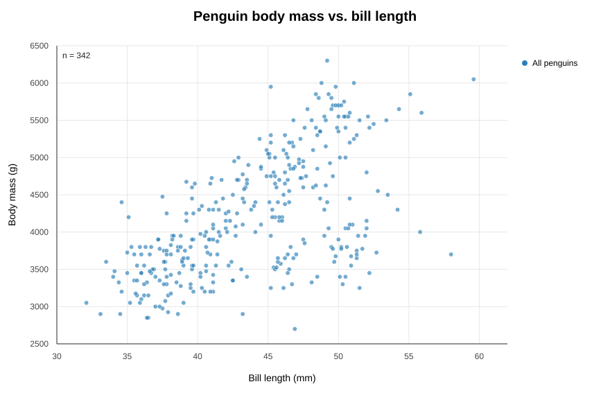
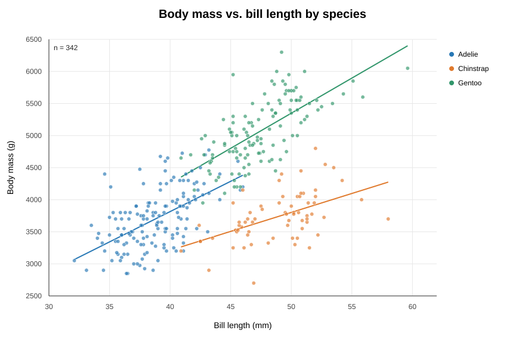
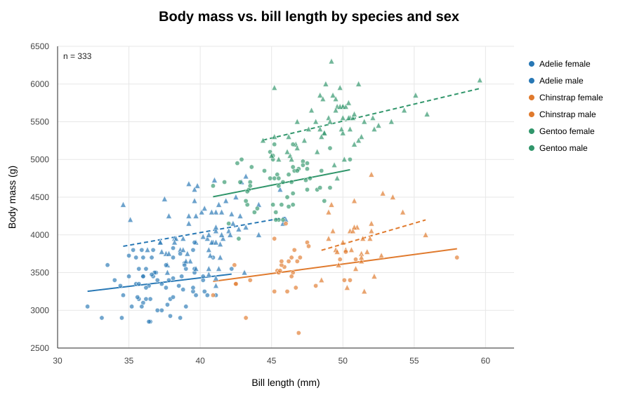

# Penguin: 몸무게와 부리 길이의 관계

- 데이터: `penguins.csv`
- 변수: `body_mass_g`(몸무게, g), `bill_length_mm`(부리 길이, mm)
- 방법: 두 변수 값이 모두 관측된 행을 대상으로 피어슨 상관계수 계산
- 전체 344행 중 두 변수의 완전 관측 행은 342개다. 성별까지 관측된 행은 333개다.

## (a) 전체 펭귄



342개 관측치의 피어슨 상관계수는 **r = 0.595**다. 전체 자료에서 몸무게가 큰 펭귄일수록 부리 길이도 긴 양의 선형 관계가 관찰된다. 이는 종을 구분하지 않고 계산한 값이다.

## (b) 종별 비교



| 종 | 표본 수 | 종 내부 피어슨 상관계수 |
|---|---:|---:|
| Adelie | 151 | 0.549 |
| Chinstrap | 68 | 0.514 |
| Gentoo | 123 | 0.669 |
| 전체 | 342 | 0.595 |

세 종 모두 양의 상관을 보인다. 따라서 전체 관계가 종간 평균 차이만으로 만들어진 것은 아니며, 종 내부에서도 몸무게와 부리 길이는 함께 증가하는 경향이 있다. 다만 종별 상관의 크기는 서로 같지 않다.

## (c) 종과 성별을 함께 구분



| 종 | 성별 | 표본 수 | 피어슨 상관계수 |
|---|---|---:|---:|
| Adelie | 암컷 | 73 | 0.170 |
| Adelie | 수컷 | 73 | 0.220 |
| Chinstrap | 암컷 | 34 | 0.276 |
| Chinstrap | 수컷 | 34 | 0.238 |
| Gentoo | 암컷 | 58 | 0.272 |
| Gentoo | 수컷 | 61 | 0.391 |

성별이 관측된 333개 행만 모은 전체 상관계수는 **r = 0.589**다. 여섯 종·성별 집단의 상관계수는 모두 양수지만 0.170~0.391로, 종별로만 나눴을 때의 0.514~0.669보다 작다. 집단별 표본 수가 34~73이므로 이 계수는 기술적 비교로 해석한다.

세 종 모두 수컷의 평균 부리 길이와 평균 몸무게가 암컷보다 크다.

| 종 | 암컷 평균 부리 길이 (mm) | 수컷 평균 부리 길이 (mm) | 차이 (mm) | 암컷 평균 몸무게 (g) | 수컷 평균 몸무게 (g) | 차이 (g) |
|---|---:|---:|---:|---:|---:|---:|
| Adelie | 37.26 | 40.39 | +3.13 | 3,368.8 | 4,043.5 | +674.7 |
| Chinstrap | 46.57 | 51.09 | +4.52 | 3,527.2 | 3,939.0 | +411.8 |
| Gentoo | 45.56 | 49.47 | +3.91 | 4,679.7 | 5,484.8 | +805.1 |

### 전체 상관계수 하나로는 보이지 않는 점

전체 r = 0.595는 종과 성별 집단 간 평균 차이, 그리고 각 집단 내부의 관계가 합쳐진 요약값이다. 이 값 하나만 보면 어떤 집단의 평균 몸무게·부리 길이가 더 큰지, 각 종·성별 내부 상관이 얼마나 다른지 알 수 없다. 종·성별 집단으로 나누면 상관이 더 약하게 나타나므로, 전체 상관을 모든 집단 내부에 그대로 적용하면 관계를 과장해 설명할 수 있다. 따라서 집단 구성과 평균 차이, 집단 내부 상관을 함께 보고해야 한다.

성별 결측은 전체 자료에서 11행이다. 그중 몸무게와 부리 길이가 모두 관측된 9행은 성별별 분석에서 제외되어, (c)의 표본 수 합계는 333이다. (a), (b)의 계산에는 성별 결측 여부를 적용하지 않아 342행을 사용했다.

## 재현 코드

```python
import pandas as pd

df = pd.read_csv("penguins.csv")
x = df[["species", "sex", "bill_length_mm", "body_mass_g"]]
xy = x.dropna(subset=["bill_length_mm", "body_mass_g"])

# (a) 전체
print(xy[["bill_length_mm", "body_mass_g"]].corr().iloc[0, 1])

# (b) 종별 표본 수와 상관계수
print(xy.groupby("species").apply(
    lambda g: pd.Series({
        "n": len(g),
        "r": g["bill_length_mm"].corr(g["body_mass_g"]),
    }), include_groups=False
))

# (c) 종·성별별 표본 수와 상관계수
xys = xy.dropna(subset=["sex"])
print(xys.groupby(["species", "sex"]).apply(
    lambda g: pd.Series({
        "n": len(g),
        "r": g["bill_length_mm"].corr(g["body_mass_g"]),
        "mean_bill_length": g["bill_length_mm"].mean(),
        "mean_body_mass": g["body_mass_g"].mean(),
    }), include_groups=False
))
```

산점도 SVG는 이 폴더의 `penguins_overall.svg`, `penguins_by_species.svg`, `penguins_by_species_sex.svg`에 있다.