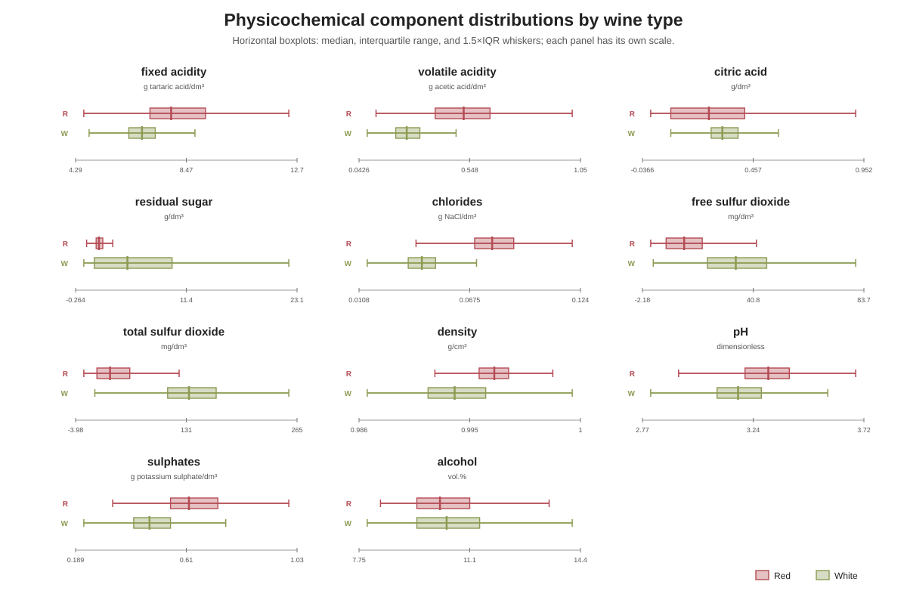
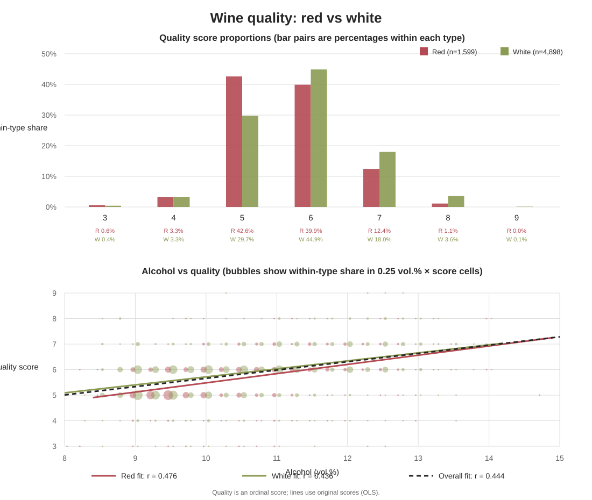

# 문제 2-8. 레드 와인과 화이트 와인의 품질 분석

데이터: `winequality-red.csv`, `winequality-white.csv`  
분석 단위: 와인 시료 1개  
결합 후 관측 수: 6,497개 (레드 1,599개, 화이트 4,898개)

## (a) 변수 확인 및 두 파일 결합

두 파일은 동일한 12개 변수로 구성되어 있으며, 원본 CSV는 세미콜론(`;`)으로 구분되어 있다. 물리화학 특성 11개는 `float64`, 품질 점수 `quality`는 `int64`이다. `quality`는 숫자로 저장되어 있지만 0~10점 척도의 순서형 감각 평가 점수다. 두 파일 모두 결측값은 없었다.

| 변수 | 자료형 | 측정 단위·의미 |
|---|---|---|
| `fixed acidity` | 실수형 | g(주석산)/dm³ |
| `volatile acidity` | 실수형 | g(아세트산)/dm³ |
| `citric acid` | 실수형 | g/dm³ |
| `residual sugar` | 실수형 | g/dm³ |
| `chlorides` | 실수형 | g(염화나트륨)/dm³ |
| `free sulfur dioxide` | 실수형 | mg/dm³ |
| `total sulfur dioxide` | 실수형 | mg/dm³ |
| `density` | 실수형 | g/cm³ |
| `pH` | 실수형 | 단위 없음 |
| `sulphates` | 실수형 | g(황산칼륨)/dm³ |
| `alcohol` | 실수형 | 부피 백분율(vol.%) |
| `quality` | 정수형 | 감각 평가 점수(0~10점, 순서형) |
| `type` | 문자열형 | 와인 종류: `red` 또는 `white` |

`type`을 추가해 행 방향으로 결합했다. 결과는 6,497행 × 13열이며, 결합 후에도 결측값은 없었다.

```python
import pandas as pd

red = pd.read_csv("winequality-red.csv", sep=";").assign(type="red")
white = pd.read_csv("winequality-white.csv", sep=";").assign(type="white")
wine = pd.concat([red, white], ignore_index=True)
```

## (b) 품질 점수와 주요 성분 분포 비교

표본 수가 다르므로 품질 점수는 각 종류 내부 비율(%)로 비교했다. 와인 종류별 표본 수는 그래프 범례에 표시했다. 물리화학 변수는 단위와 범위가 서로 다르므로 변수마다 축을 분리한 상자그림으로 비교했다. 상자그림은 표본 수가 달라도 중앙값과 사분위 범위를 비교할 수 있고, 각 성분의 분포 폭도 확인할 수 있다.

### 품질 점수 비율

| 점수 | 레드 (%) | 화이트 (%) |
|---:|---:|---:|
| 3 | 0.63 | 0.41 |
| 4 | 3.31 | 3.33 |
| 5 | 42.59 | 29.75 |
| 6 | 39.90 | 44.88 |
| 7 | 12.45 | 17.97 |
| 8 | 1.13 | 3.57 |
| 9 | 0.00 | 0.10 |

두 종류의 품질 점수 중앙값은 모두 6점이고 사분위 범위는 모두 5~6점이다. 다만 레드는 5점 비율이 높고(42.59% 대 29.75%), 화이트는 6~8점 비율이 상대적으로 높다. 따라서 중앙값만 보면 비슷하지만 분포 전체는 같지 않다.

### 주요 성분의 중앙값과 사분위 범위

괄호는 Q1~Q3이다. 단위는 (a)의 단위 정의를 따른다.

| 변수 | 레드: 중앙값 (Q1~Q3) | 화이트: 중앙값 (Q1~Q3) |
|---|---:|---:|
| `fixed acidity` | 7.9 (7.1~9.2) | 6.8 (6.3~7.3) |
| `volatile acidity` | 0.52 (0.39~0.64) | 0.26 (0.21~0.32) |
| `citric acid` | 0.26 (0.09~0.42) | 0.32 (0.27~0.39) |
| `residual sugar` | 2.2 (1.9~2.6) | 5.2 (1.7~9.9) |
| `chlorides` | 0.079 (0.070~0.090) | 0.043 (0.036~0.050) |
| `free sulfur dioxide` | 14 (7~21) | 34 (23~46) |
| `total sulfur dioxide` | 38 (22~62) | 134 (108~167) |
| `density` | 0.997 (0.996~0.998) | 0.994 (0.992~0.996) |
| `pH` | 3.31 (3.21~3.40) | 3.18 (3.09~3.28) |
| `sulphates` | 0.62 (0.55~0.73) | 0.47 (0.41~0.55) |
| `alcohol` | 10.2 (9.5~11.1) | 10.4 (9.5~11.4) |

화이트는 잔류당과 이산화황(유리 및 총량)의 중앙값이 더 높다. 레드는 고정산도·휘발산도·염화물·황산염과 pH 중앙값이 더 높다. 알코올 중앙값은 두 종류가 비슷하다.



## (c) 알코올 도수와 품질 점수의 관계

Pearson 상관은 선형 관계를, Spearman 순위상관은 순서형 품질 점수와의 단조 관계를 확인하기 위해 계산했다.

| 집단 | n | Pearson 상관계수 | Spearman 순위상관계수 |
|---|---:|---:|---:|
| 전체 | 6,497 | 0.444 | 0.447 |
| 레드 | 1,599 | 0.476 | 0.479 |
| 화이트 | 4,898 | 0.436 | 0.440 |

세 집단 모두에서 알코올 도수와 품질 점수는 양의 관계를 보인다. 종류별 상관계수도 비슷하므로, 와인 종류를 합쳤다고 관계 방향이 반대로 나타나는 Simpson 역설은 관찰되지 않는다. 단순 선형회귀의 기울기는 알코올 1 vol.% 증가당 레드 약 0.361점, 화이트 약 0.313점, 전체 약 0.325점이다.

그렇지만 전체 분석에서 와인 종류를 고려할 필요가 있다. `quality ~ alcohol` 모형에 와인 종류를 추가한 `quality ~ alcohol + type` 모형에서 R²는 0.197에서 0.208로 증가했다. 알코올 도수를 같게 놓았을 때 화이트의 평균 품질 점수는 레드보다 약 0.212점 높은 것으로 추정됐다. 상관계수 차이는 크지 않지만 종류별 품질 수준에 차이가 남으므로, 통합 자료의 설명·예측 모형에서는 `type`을 함께 포함하는 편이 적절하다. 종류별 알코올 기울기가 중요한 질문이라면 상호작용도 검토할 수 있다.



아래 관계 그래프의 풍선은 알코올 도수를 0.25 vol.% 구간으로 나누고 각 구간·점수 조합의 비율을 종류별로 정규화해 표시했다. 회귀선과 상관계수는 구간화하지 않은 원자료로 계산했다. 상관과 회귀 결과는 관찰 자료의 연관성을 나타내며, 알코올 도수가 품질 점수를 높인다는 인과 효과를 뜻하지 않는다.

## 재현용 pandas 코드

```python
from scipy.stats import pearsonr, spearmanr, linregress

for label, group in [
    ("전체", wine),
    ("레드", wine[wine["type"] == "red"]),
    ("화이트", wine[wine["type"] == "white"]),
]:
    print(label, len(group),
          pearsonr(group["alcohol"], group["quality"]),
          spearmanr(group["alcohol"], group["quality"]))

print(wine.groupby("type")["quality"].agg(["count", "mean", "median"]))

# 종류별 품질 비율(%)
print(pd.crosstab(wine["quality"], wine["type"], normalize="columns").mul(100))

# 알코올 1 vol.% 증가당 품질 점수의 단순 선형회귀 기울기
for label, group in [("전체", wine), ("레드", wine[wine.type == "red"]),
                     ("화이트", wine[wine.type == "white"])]:
    fit = linregress(group["alcohol"], group["quality"])
    print(label, "slope=", fit.slope, "R2=", fit.rvalue**2)
```
