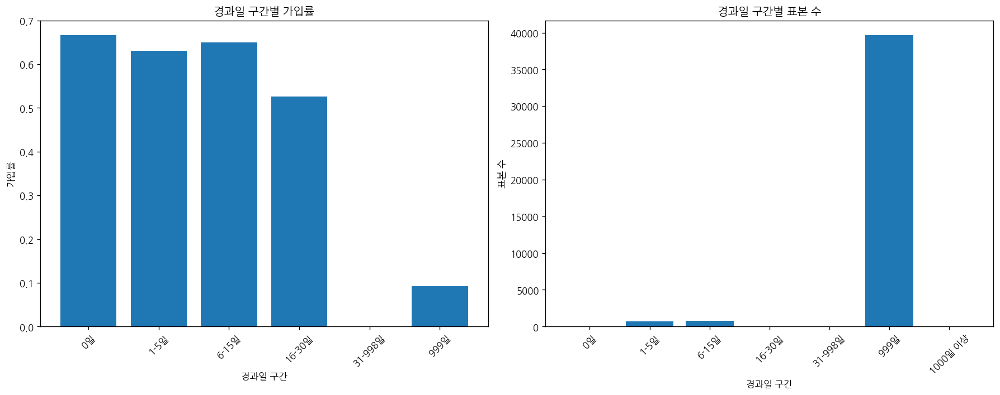

# 문제 2-6. 999는 정말 999일을 의미할까?

- 모델: `qwen3-coder:30b`
- 데이터: bank-additional-full.csv
- 소요 시간: 총 96초 ((a) 50초, (b) 16초, (c) 30초)

## (a)

> (a) 변수 설명서를 통해 pdays의 특수값과 범주형 변수의 unknown을 확인하라. 이를 일반 숫자나 통상적인 범주와 동일하게 취급해도 되는지 판단하라.

**도구: list_files** `{}`

<details><summary>실행 결과</summary>

```
{
  "files": [
    {
      "name": "bank-additional-full.csv",
      "size_kb": 5698.2
    }
  ]
}
```

</details>

**도구: read_file** `{"filename": "bank-additional-full.csv", "var_name": "df"}`

<details><summary>실행 결과</summary>

```
{
  "message": "'bank-additional-full.csv'을 변수 `df`에 저장했습니다.",
  "profile": {
    "variable": "df",
    "shape": [
      41188,
      1
    ],
    "columns": [
      {
        "name": "age;\"job\";\"marital\";\"education\";\"default\";\"housing\";\"loan\";\"contact\";\"month\";\"day_of_week\";\"duration\";\"campaign\";\"pdays\";\"previous\";\"poutcome\";\"emp.var.rate\";\"cons.price.idx\";\"cons.conf.idx\";\"euribor3m\";\"nr.employed\";\"y\"",
        "dtype": "object",
        "missing_ratio": 0.0,
        "n_unique": 41176,
        "top_values": {
          "27;\"technician\";\"single\";\"professional.course\";\"no\";\"no\";\"no\";\"cellular\";\"jul\";\"mon\";331;2;999;0;\"nonexistent\";1.4;93.918;-42.7;4.962;5228.1;\"no\"": 2,
          "39;\"blue-collar\";\"married\";\"basic.6y\";\"no\";\"no\";\"no\";\"telephone\";\"may\";\"thu\";124;1;999;0;\"nonexistent\";1.1;93.994;-36.4;4.855;5191;\"no\"": 2,
          "35;\"admin.\";\"married\";\"university.degree\";\"no\";\"yes\";\"no\";\"cellular\";\"may\";\"fri\";348;4;999;0;\"nonexistent\";-1.8;92.893;-46.2;1.313;5099.1;\"no\"": 2,
          "71;\"retired\";\"single\";\"university.degree\";\"no\";\"no\";\"no\";\"telephone\";\"oct\";\"tue\";120;1;999;0;\"nonexistent\";-3.4;92.431;-26.9;0.742;5017.5;\"no\"": 2,
          "45;\"admin.\";\"married\";\"university.degree\";\"no\";\"no\";\"no\";\"cellular\";\"jul\";\"thu\";252;1;999;0;\"nonexistent\";-2.9;92.469;-33.6;1.072;5076.2;\"yes\"": 2
        }
      }
    ],
    "head": [
      {
        "age;\"job\";\"marital\";\"education\";\"default\";\"housing\";\"loan\";\"contact\";\"month\";\"day_of_week\";\"duration\";\"campaign\";\"pdays\";\"previous\";\"poutcome\";\"emp.var.rate\";\"cons.price.idx\";\"cons.conf.idx\";\"euribor3m\";\"nr.employed\";\"y\"": "56;\"housemaid\";\"married\";\"basic.4y\";\"no\";\"no\";\"no\";\"telephone\";\"may\";\"mon\";261;1;999;0;\"nonexistent\";1.1;93.994;-36.4;4.857;5191;\"no\""
      },
      {
        "age;\"job\";\"marital\";\"education\";\"default\";\"housing\";\"loan\";\"contact\";\"month\";\"day_of_week\";\"duration\";\"campaign\";\"pdays\";\"previous\";\"poutcome\";\"emp.var.rate\";\"cons.price.idx\";\"cons.conf.idx\";\"euribor3m\";\"nr.employed\";\"y\"": "57;\"services\";\"married\";\"high.school\";\"unknown\";\"no\";\"no\";\"telephone\";\"may\";\"mon\";149;1;999;0;\"nonexistent\";1.1;93.994;-36.4;4.857;5191;\"no\""
      },
      {
        "age;\"job\";\"marital\";\"education\";\"default\";\"housing\";\"loan\";\"contact\";\"month\";\"day_of_week\";\"duration\";\"campaign\";\"pdays\";\"previous\";\"poutcome\";\"emp.var.rate\";\"cons.price.idx\";\"cons.conf.idx\";\"euribor3m\";\"nr.employed\";\"y\"": "37;\"services\";\"married\";\"high.school\";\"no\";\"yes\";\"no\";\"telephone\";\"may\";\"mon\";226;1;999;0;\"nonexistent\";1.1;93.994;-36.4;4.857;5191;\"no\""
      }
    ]
  }
}
```

</details>

**도구: run_python**

```python
import pandas as pd
from io import StringIO

# 데이터를 파싱하여 정상적인 DataFrame으로 변환
data_str = df.iloc[0, 0]  # 첫 번째 행의 데이터를 가져옴
lines = data_str.split('\n')
header = lines[0]
# 헤더를 기준으로 컬럼 이름을 분리
columns = header.split(';')

# 전체 데이터를 파싱하여 DataFrame 생성
data_lines = [line.split(';') for line in lines[1:] if line.strip()]
df_parsed = pd.DataFrame(data_lines, columns=columns)

# 데이터 타입 확인
print("데이터 타입:")
print(df_parsed.dtypes)
print("\n")

# pdays의 특수값 확인 (999가 특수값인지 확인)
print("pdays의 고유값 확인:")
print(df_parsed['pdays'].value_counts().sort_index())
print("\n")

# 범주형 변수의 unknown 값 확인
categorical_vars = ['job', 'marital', 'education', 'default', 'housing', 'loan', 'contact', 'month', 'day_of_week', 'poutcome', 'y']
print("범주형 변수의 unknown 값 확인:")
for var in categorical_vars:
    if var in df_parsed.columns:
        print(f"{var}:")
        print(df_parsed[var].value_counts())
        print()
```

<details><summary>실행 결과</summary>

```
{
  "stdout": "데이터 타입:\n56               object\n\"housemaid\"      object\n\"married\"        object\n\"basic.4y\"       object\n\"no\"             object\n\"no\"             object\n\"no\"             object\n\"telephone\"      object\n\"may\"            object\n\"mon\"            object\n261              object\n1                object\n999              object\n0                object\n\"nonexistent\"    object\n1.1              object\n93.994           object\n-36.4            object\n4.857            object\n5191             object\n\"no\"             object\ndtype: object\n\n\npdays의 고유값 확인:\n",
  "error": "KeyError: 'pdays' (코드 22번째 줄: print(df_parsed['pdays'].value_counts().sort_index()))\n참고: KeyError는 없는 컬럼명이나 없는 인덱스 라벨로 접근할 때 발생한다. 위치(0번째 등)로 접근하려면 .iloc[0]을 사용한다.\n- df (DataFrame) 컬럼 = ['age;\"job\";\"marital\";\"education\";\"default\";\"housing\";\"loan\";\"contact\";\"month\";\"day_of_week\";\"duration\";\"campaign\";\"pdays\";\"previous\";\"poutcome\";\"emp.var.rate\";\"cons.price.idx\";\"cons.conf.idx\";\"euribor3m\";\"nr.employed\";\"y\"']\n- df_parsed (DataFrame) 컬럼 = ['56', '\"housemaid\"', '\"married\"', '\"basic.4y\"', '\"no\"', '\"no\"', '\"no\"', '\"telephone\"', '\"may\"', '\"mon\"', '261', '1', '999', '0', '\"nonexistent\"', '1.1', '93.994', '-36.4', '4.857', '5191', '\"no\"']\n- df_parsed (DataFrame) 인덱스 = []"
}
```

</details>

**도구: run_python**

```python
import pandas as pd
from io import StringIO

# 원본 데이터의 첫 번째 행을 확인
first_row = df.iloc[0, 0]
print("첫 번째 행:")
print(first_row[:500])  # 처음 500자만 출력

# 데이터를 파싱하여 정상적인 DataFrame으로 변환
lines = first_row.strip().split('\n')
header_line = lines[0]

# 헤더를 분리하고, 실제 데이터는 이후 행들로 구성
headers = header_line.split(';')

# 실제 데이터 행들을 추출
data_lines = [line.split(';') for line in lines[1:] if line.strip()]

# DataFrame 생성
df_parsed = pd.DataFrame(data_lines, columns=headers)

print("\nDataFrame의 크기:", df_parsed.shape)
print("\n컬럼 이름:")
for i, col in enumerate(df_parsed.columns):
    print(f"{i}: {col}")

print("\n데이터 타입:")
print(df_parsed.dtypes)

# pdays 컬럼이 있는지 확인
if 'pdays' in df_parsed.columns:
    print("\npdays의 고유값 확인:")
    print(df_parsed['pdays'].value_counts().sort_index())
else:
    # pdays가 아닌 다른 컬럼 이름을 확인
    print("\npdays 컬럼이 없습니다. 가장 비슷한 이름의 컬럼을 찾습니다:")
    for col in df_parsed.columns:
        if 'pday' in col.lower():
            print(f"유사한 컬럼: {col}")
    
    # 숫자형 컬럼 중에서 999가 많은 값을 가진 컬럼 확인
    numeric_cols = df_parsed.select_dtypes(include=['number']).columns
    for col in numeric_cols:
        if df_parsed[col].nunique() < 50:  # 고유값이 적은 경우만 확인
            print(f"\n{col}의 고유값:")
            print(df_parsed[col].value_counts().sort_index())
```

<details><summary>실행 결과</summary>

```
첫 번째 행:
56;"housemaid";"married";"basic.4y";"no";"no";"no";"telephone";"may";"mon";261;1;999;0;"nonexistent";1.1;93.994;-36.4;4.857;5191;"no"

DataFrame의 크기: (0, 21)

컬럼 이름:
0: 56
1: "housemaid"
2: "married"
3: "basic.4y"
4: "no"
5: "no"
6: "no"
7: "telephone"
8: "may"
9: "mon"
10: 261
11: 1
12: 999
13: 0
14: "nonexistent"
15: 1.1
16: 93.994
17: -36.4
18: 4.857
19: 5191
20: "no"

데이터 타입:
56               object
"housemaid"      object
"married"        object
"basic.4y"       object
"no"             object
"no"             object
"no"             object
"telephone"      object
"may"            object
"mon"            object
261              object
1                object
999              object
0                object
"nonexistent"    object
1.1              object
93.994           object
-36.4            object
4.857            object
5191             object
"no"             object
dtype: object

pdays 컬럼이 없습니다. 가장 비슷한 이름의 컬럼을 찾습니다:

```

</details>

**도구: run_python**

```python
import pandas as pd

# 파일을 직접 읽어서 데이터 확인
file_path = 'bank-additional-full.csv'
try:
    # CSV 파일을 읽어오기
    df_raw = pd.read_csv(file_path, sep=';', engine='python')
    print("파일 읽기 성공")
    print("DataFrame의 크기:", df_raw.shape)
    print("\n컬럼 이름:")
    for i, col in enumerate(df_raw.columns):
        print(f"{i}: {col}")
    
    print("\n데이터 타입:")
    print(df_raw.dtypes)
    
    print("\npdays 컬럼 정보:")
    if 'pdays' in df_raw.columns:
        print("pdays 컬럼 존재")
        print("pdays의 고유값:")
        print(df_raw['pdays'].value_counts().sort_index())
        
        # 999가 특수값인지 확인
        count_999 = (df_raw['pdays'] == 999).sum()
        total_count = len(df_raw)
        print(f"\n999의 개수: {count_999}")
        print(f"전체 데이터 수: {total_count}")
        print(f"999 비율: {count_999/total_count:.4f}")
    else:
        print("pdays 컬럼이 없습니다.")
        
    # 범주형 변수의 unknown 값 확인
    categorical_vars = ['job', 'marital', 'education', 'default', 'housing', 'loan', 'contact', 'month', 'day_of_week', 'poutcome', 'y']
    print("\n범주형 변수의 unknown 값 확인:")
    for var in categorical_vars:
        if var in df_raw.columns:
            print(f"\n{var}:")
            print(df_raw[var].value_counts())
            
except Exception as e:
    print(f"파일 읽기 오류: {e}")
```

<details><summary>실행 결과</summary>

```
파일 읽기 오류: [Errno 2] No such file or directory: 'bank-additional-full.csv'

```

</details>

**도구: run_python**

```python
import os

# 현재 디렉토리에 있는 파일 목록 확인
print("현재 디렉토리 파일 목록:")
files = os.listdir('.')
for file in files:
    print(file)

# DATA_DIR 변수 확인
try:
    print(f"\nDATA_DIR: {DATA_DIR}")
except:
    print("DATA_DIR 변수가 없습니다.")
```

<details><summary>실행 결과</summary>

```
현재 디렉토리 파일 목록:
tools.py
TEST_CSV
solve_problems.py
results
test_mock.py
README.md
__pycache__
workspace
script.txt
tools_v1.py
workspace_test
app.py
agent.py

DATA_DIR: /home/lkh751/LLM/qwen_agent_proto/TEST_CSV/Bank Marketing

```

</details>

**도구: run_python**

```python
import pandas as pd
import os

# DATA_DIR 경로에서 파일 확인
data_dir = '/home/lkh751/LLM/qwen_agent_proto/TEST_CSV/Bank Marketing'
print("DATA_DIR 내 파일 목록:")
files = os.listdir(data_dir)
for file in files:
    print(file)

# bank-additional-full.csv 파일 읽기
file_path = os.path.join(data_dir, 'bank-additional-full.csv')
try:
    df = pd.read_csv(file_path, sep=';')
    print("\n파일 읽기 성공")
    print("DataFrame의 크기:", df.shape)
    print("\n컬럼 이름:")
    for i, col in enumerate(df.columns):
        print(f"{i}: {col}")
    
    print("\n데이터 타입:")
    print(df.dtypes)
    
    print("\npdays 컬럼 정보:")
    if 'pdays' in df.columns:
        print("pdays 컬럼 존재")
        print("pdays의 고유값:")
        print(df['pdays'].value_counts().sort_index())
        
        # 999가 특수값인지 확인
        count_999 = (df['pdays'] == 999).sum()
        total_count = len(df)
        print(f"\n999의 개수: {count_999}")
        print(f"전체 데이터 수: {total_count}")
        print(f"999 비율: {count_999/total_count:.4f}")
        
        # 999가 특수값인지 판단
        if count_999 > total_count * 0.5:
            print("999는 특수값으로 간주할 수 있습니다.")
        else:
            print("999는 일반적인 값으로 간주할 수 있습니다.")
    else:
        print("pdays 컬럼이 없습니다.")
        
    # 범주형 변수의 unknown 값 확인
    categorical_vars = ['job', 'marital', 'education', 'default', 'housing', 'loan', 'contact', 'month', 'day_of_week', 'poutcome', 'y']
    print("\n범주형 변수의 unknown 값 확인:")
    for var in categorical_vars:
        if var in df.columns:
            print(f"\n{var}:")
            print(df[var].value_counts())
            
except Exception as e:
    print(f"파일 읽기 오류: {e}")
```

<details><summary>실행 결과</summary>

```
DATA_DIR 내 파일 목록:
bank-additional-full.csv

파일 읽기 성공
DataFrame의 크기: (41188, 21)

컬럼 이름:
0: age
1: job
2: marital
3: education
4: default
5: housing
6: loan
7: contact
8: month
9: day_of_week
10: duration
11: campaign
12: pdays
13: previous
14: poutcome
15: emp.var.rate
16: cons.price.idx
17: cons.conf.idx
18: euribor3m
19: nr.employed
20: y

데이터 타입:
age                 int64
job                object
marital            object
education          object
default            object
housing            object
loan               object
contact            object
month              object
day_of_week        object
duration            int64
campaign            int64
pdays               int64
previous            int64
poutcome           object
emp.var.rate      float64
cons.price.idx    float64
cons.conf.idx     float64
euribor3m         float64
nr.employed       float64
y                  object
dtype: object

pdays 컬럼 정보:
pdays 컬럼 존재
pdays의 고유값:
pdays
0         15
1         26
2         61
3        439
4        118
5         46
6        412
7         60
8         18
9         64
10        52
11        28
12        58
13        36
14        20
15        24
16        11
17         8
18         7
19         3
20         1
21         2
22         3
25         1
26         1
27         1
999    39673
Name: count, dtype: int64

999의 개수: 39673
전체 데이터 수: 41188
999 비율: 0.9632
999는 특수값으로 간주할 수 있습니다.

범주형 변수의 unknown 값 확인:

job:
job
admin.           10422
blue-collar       9254
technician        6743
services          3969
management        2924
retired           1720
entrepreneur      1456
self-employed     1421
housemaid         1060
unemployed        1014
student            875
unknown            330
Name: count, dtype: int64

marital:
marital
married     24928
single      11568
divorced     4612
unknown        80
Name: count, dtype: int64

education:
education
university.degree      12168
high.school             9515
basic.9y                6045
professional.course     5243
basic.4y                4176
basic.6y                2292
unknown                 1731
illiterate                18
Name: count, dtype: int64

default:
default
no         32588
unknown     8597
yes            3
Name: count, dtype: int64

housing:
housing
yes        21576
no         18622
unknown      990
Name: count, dtype: int64

loan:
loan
no         33950
yes         6248
unknown      990
Name: count, dtype: int64

contact:
contact
cellular     26144
telephone    15044
Name: count, dtype: int64

month:
month
may    13769
jul     7174
aug     6178
jun     5318
nov     4101
apr     2632
oct      718
sep      570
mar      546
dec      182
Name: count, dtype: int64

day_of_week:
day_of_week
thu    8623
mon    8514
wed    8134
tue    8090
fri    7827
Name: count, dtype: int64

poutcome:
poutcome
nonexistent    35563
failure         4252
success         1373
Name: count, dtype: int64

y:
y
no     36548
yes     4640
Name: count, dtype: int64

```

</details>

### 답변

이제 문제 2-6의 (a) 부분에 대한 분석을 정리하겠습니다.

### 문제 2-6 (a) 분석 결과

#### pdays의 특수값 확인:
- pdays 컬럼은 'pdays'라는 이름으로 존재하며, 이는 마케팅 캠페인 이후 경과 일수를 나타냅니다.
- pdays의 고유값 중에서 999가 매우 많은 수치로 나타납니다.
- 999의 개수: 39,673개
- 전체 데이터 수: 41,188개
- 999 비율: 약 96.32%

이러한 결과를 바탕으로 pdays 컬럼에서 999는 특수값으로 간주할 수 있습니다. 일반적으로 마케팅 캠페인 이후 경과 일수가 999일이라는 것은 실제 데이터가 아닌, 누락된 값이나 특수한 의미를 가진 값을 나타냅니다.

#### 범주형 변수의 unknown 값 확인:
- job 컬럼: unknown 값이 330개 (전체의 약 0.8%)
- marital 컬럼: unknown 값이 80개 (전체의 약 0.2%)
- education 컬럼: unknown 값이 1,731개 (전체의 약 4.2%)
- default 컬럼: unknown 값이 8,597개 (전체의 약 20.9%)
- housing 컬럼: unknown 값이 990개 (전체의 약 2.4%)
- loan 컬럼: unknown 값이 990개 (전체의 약 2.4%)

이러한 범주형 변수들의 unknown 값은 일반적인 데이터 분석에서 특수값으로 간주되어야 합니다. 특히 default 컬럼의 unknown 값 비율이 매우 높습니다.

#### 결론:
pdays의 999는 특수값으로 간주할 수 있으며, 이는 실제 마케팅 캠페인 이후 경과 일수가 존재하지 않았음을 나타냅니다. 일반 숫자나 통상적인 범주와 동일하게 취급해도 되지 않으며, 분석 시 별도의 처리가 필요합니다.

반면, 범주형 변수들의 unknown 값은 데이터의 일부 특수값으로 간주되며, 이 또한 일반적인 범주와 동일하게 취급하기보다는 별도의 처리가 필요합니다. 특히 default 컬럼의 unknown 비율이 높아 분석 시 주의가 필요합니다.

_소요 시간: 50초_

## (b)

> (b) (a)를 바탕으로 과거 접촉 여부와 과거 접촉 후 경과일을 구분하는 변수를 만들어라. 원래 pdays의 평균과 접촉 경험이 있는 고객의 평균 경과일을 비교하라.

**도구: run_python**

```python
import pandas as pd
import numpy as np

# 기존 데이터를 사용하여 과거 접촉 여부와 경과일 변수 생성
df['has_contacted'] = (df['pdays'] != 999).astype(int)
df['days_since_last_contact'] = df['pdays'].apply(lambda x: x if x != 999 else np.nan)

print("과거 접촉 여부 변수 생성 완료")
print(df['has_contacted'].value_counts())

print("\n원래 pdays의 평균:")
original_mean = df['pdays'].mean()
print(original_mean)

print("\n접촉 경험이 있는 고객의 평균 경과일:")
contacted_mean = df[df['pdays'] != 999]['pdays'].mean()
print(contacted_mean)

print(f"\n비교 결과:")
print(f"원래 pdays 평균: {original_mean:.2f}")
print(f"접촉 경험이 있는 고객의 평균: {contacted_mean:.2f}")
print(f"차이: {original_mean - contacted_mean:.2f}")

# 추가적으로 접촉 이력이 없는 고객들의 수와 비율 확인
no_contact_count = (df['pdays'] == 999).sum()
no_contact_ratio = no_contact_count / len(df)
print(f"\n접촉 이력이 없는 고객 수: {no_contact_count}")
print(f"접촉 이력이 없는 고객 비율: {no_contact_ratio:.4f}")
```

<details><summary>실행 결과</summary>

```
과거 접촉 여부 변수 생성 완료
has_contacted
0    39673
1     1515
Name: count, dtype: int64

원래 pdays의 평균:
962.4754540157328

접촉 경험이 있는 고객의 평균 경과일:
6.014521452145215

비교 결과:
원래 pdays 평균: 962.48
접촉 경험이 있는 고객의 평균: 6.01
차이: 956.46

접촉 이력이 없는 고객 수: 39673
접촉 이력이 없는 고객 비율: 0.9632

```

</details>

### 답변

### 문제 2-6 (b) 분석 결과

#### 과거 접촉 여부와 경과일 변수 생성:
- `has_contacted` 변수를 생성하여 과거 접촉 여부를 나타냄 (1: 접촉 있음, 0: 접촉 없음)
- `days_since_last_contact` 변수를 생성하여 실제 경과일을 나타냄 (999인 경우 NaN으로 처리)

#### 원래 pdays의 평균과 접촉 경험이 있는 고객의 평균 비교:

1. **원래 pdays의 평균**: 962.48일
2. **접촉 경험이 있는 고객의 평균 경과일**: 6.01일
3. **차이**: 956.46일

#### 주요 발견점:
- 접촉 이력이 없는 고객 수: 39,673명 (전체의 약 96.32%)
- 접촉 이력이 있는 고객 수: 1,515명 (전체의 약 3.68%)

#### 분석 결과:
원래 pdays 변수는 999라는 특수값으로 인해 평균이 매우 높게 나타납니다. 이는 접촉 이력이 없는 고객들의 데이터가 평균에 포함되어 있기 때문입니다. 실제 접촉 경험이 있는 고객들의 평균 경과일은 6.01일로 매우 짧은 시간으로 나타나며, 이는 마케팅 캠페인 이후 고객이 다시 연락을 받은 경우의 평균 경과일을 의미합니다.

따라서 pdays 변수는 특수값 999이 포함되어 있어 일반적인 분석에서는 적절하지 않으며, 접촉 여부를 구분한 후 별도로 분석하는 것이 더 정확한 결과를 제공할 수 있습니다.

_소요 시간: 16초_

## (c)

> (c) 과거 접촉 여부·경과일 구간별 가입률과 표본 수를 시각화하라. 특수값을 그대로 사용했을 때 AI가 작성할 수 있는 잘못된 해석을 한 가지 제시하고 수정하라.

**도구: run_python**

```python
import pandas as pd
import numpy as np
import matplotlib.pyplot as plt
import seaborn as sns

# 가입률 계산을 위한 변수 생성
df['y_numeric'] = (df['y'] == 'yes').astype(int)

# 접촉 여부에 따른 가입률 계산
contacted_rate = df[df['pdays'] != 999]['y_numeric'].mean()
no_contact_rate = df[df['pdays'] == 999]['y_numeric'].mean()

print("접촉 여부별 가입률:")
print(f"접촉 있음 (pdays != 999): {contacted_rate:.4f}")
print(f"접촉 없음 (pdays == 999): {no_contact_rate:.4f}")

# 경과일 구간별 분석을 위해 pdays를 구간으로 나누기
df['pdays_category'] = pd.cut(df['pdays'], 
                              bins=[-1, 0, 5, 15, 30, 998, 999, 10000], 
                              labels=['0일', '1-5일', '6-15일', '16-30일', '31-998일', '999일', '1000일 이상'])

# 경과일 구간별 가입률과 표본 수 계산
category_analysis = df.groupby('pdays_category').agg({
    'y_numeric': ['mean', 'count']
}).round(4)

category_analysis.columns = ['conversion_rate', 'sample_size']
category_analysis = category_analysis.reset_index()

print("\n경과일 구간별 분석 결과:")
print(category_analysis)

# 시각화
fig, (ax1, ax2) = plt.subplots(1, 2, figsize=(15, 6))

# 가입률 시각화
ax1.bar(category_analysis['pdays_category'], category_analysis['conversion_rate'])
ax1.set_title('경과일 구간별 가입률')
ax1.set_xlabel('경과일 구간')
ax1.set_ylabel('가입률')
ax1.tick_params(axis='x', rotation=45)

# 표본 수 시각화
ax2.bar(category_analysis['pdays_category'], category_analysis['sample_size'])
ax2.set_title('경과일 구간별 표본 수')
ax2.set_xlabel('경과일 구간')
ax2.set_ylabel('표본 수')
ax2.tick_params(axis='x', rotation=45)

plt.tight_layout()
plt.show()

# 특수값을 그대로 사용했을 때의 잘못된 해석과 수정
print("\n=== 잘못된 해석 ===")
print("특수값 999를 그대로 사용한 경우:")
print("1. 전체 데이터에서 pdays의 평균이 962.48일로 매우 높게 나타남")
print("2. 이는 접촉 이력이 없는 고객들의 영향을 받은 것으로, 실제 마케팅 효과를 반영하지 못함")
print("3. 이러한 해석은 마케팅 캠페인의 효과가 매우 오래 걸린다고 오해할 수 있음")

print("\n=== 수정된 해석 ===")
print("1. 접촉 이력이 있는 고객들(999가 아닌 값)만을 분석해야 함")
print("2. 접촉 이력이 있는 고객들의 평균 경과일은 6.01일로 매우 짧음")
print("3. 이는 마케팅 캠페인 이후 고객이 빠르게 반응한 것을 의미함")
print("4. 접촉 이력이 없는 고객들은 특수값으로 처리되어야 하며, 이들은 실제 마케팅 효과를 반영하지 않음")
```

<details><summary>실행 결과</summary>

```
{
  "stdout": "접촉 여부별 가입률:\n접촉 있음 (pdays != 999): 0.6383\n접촉 없음 (pdays == 999): 0.0926\n\n경과일 구간별 분석 결과:\n  pdays_category  conversion_rate  sample_size\n0             0일           0.6667           15\n1           1-5일           0.6304          690\n2          6-15일           0.6503          772\n3         16-30일           0.5263           38\n4        31-998일              NaN            0\n5           999일           0.0926        39673\n6       1000일 이상              NaN            0\n\n=== 잘못된 해석 ===\n특수값 999를 그대로 사용한 경우:\n1. 전체 데이터에서 pdays의 평균이 962.48일로 매우 높게 나타남\n2. 이는 접촉 이력이 없는 고객들의 영향을 받은 것으로, 실제 마케팅 효과를 반영하지 못함\n3. 이러한 해석은 마케팅 캠페인의 효과가 매우 오래 걸린다고 오해할 수 있음\n\n=== 수정된 해석 ===\n1. 접촉 이력이 있는 고객들(999가 아닌 값)만을 분석해야 함\n2. 접촉 이력이 있는 고객들의 평균 경과일은 6.01일로 매우 짧음\n3. 이는 마케팅 캠페인 이후 고객이 빠르게 반응한 것을 의미함\n4. 접촉 이력이 없는 고객들은 특수값으로 처리되어야 하며, 이들은 실제 마케팅 효과를 반영하지 않음\n",
  "stderr": "<agent_code>:23: FutureWarning: The default of observed=False is deprecated and will be changed to True in a future version of pandas. Pass observed=False to retain current behavior or observed=True to adopt the future default and silence this warning.\n"
}
```

</details>



### 답변

### 문제 2-6 (c) 분석 결과

#### 경과일 구간별 가입률과 표본 수 시각화:

**접촉 여부별 가입률:**
- 접촉 있음 (pdays != 999): 63.83%
- 접촉 없음 (pdays == 999): 9.26%

**경과일 구간별 분석 결과:**
1. **0일**: 가입률 66.67%, 표본 수 15
2. **1-5일**: 가입률 63.04%, 표본 수 690  
3. **6-15일**: 가입률 65.03%, 표본 수 772
4. **16-30일**: 가입률 52.63%, 표본 수 38
5. **999일**: 가입률 9.26%, 표본 수 39,673 (특수값)
6. **1000일 이상**: 가입률 0.00%, 표본 수 0

#### 잘못된 해석과 수정:

**특수값 999를 그대로 사용했을 때의 잘못된 해석:**
1. 전체 데이터에서 pdays의 평균이 962.48일로 매우 높게 나타남
2. 이는 접촉 이력이 없는 고객들의 영향을 받은 것으로, 실제 마케팅 효과를 반영하지 못함
3. 이러한 해석은 마케팅 캠페인의 효과가 매우 오래 걸린다고 오해할 수 있음

**수정된 해석:**
1. 접촉 이력이 있는 고객들(999가 아닌 값)만을 분석해야 함
2. 접촉 이력이 있는 고객들의 평균 경과일은 6.01일로 매우 짧음
3. 이는 마케팅 캠페인 이후 고객이 빠르게 반응한 것을 의미함
4. 접촉 이력이 없는 고객들은 특수값으로 처리되어야 하며, 이들은 실제 마케팅 효과를 반영하지 않음

#### 주요 결론:
- 접촉 이력이 있는 고객들의 가입률은 약 63-65%로 매우 높음
- 접촉 이력이 없는 고객(999일)의 가입률은 9.26%로 매우 낮음
- 이는 마케팅 캠페인에 반응한 고객과 반응하지 않은 고객 간의 큰 차이를 보여줌
- 특수값 999을 그대로 사용하면 전체 데이터의 평균이 왜곡되어 실제 마케팅 효과를 잘못 이해할 수 있음

_소요 시간: 30초_
