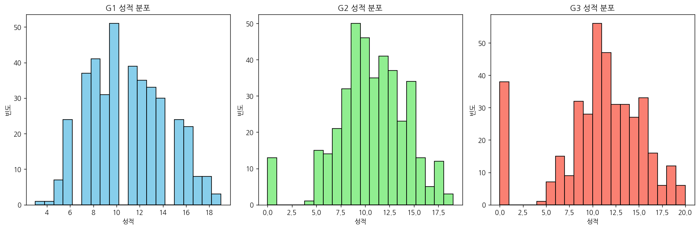
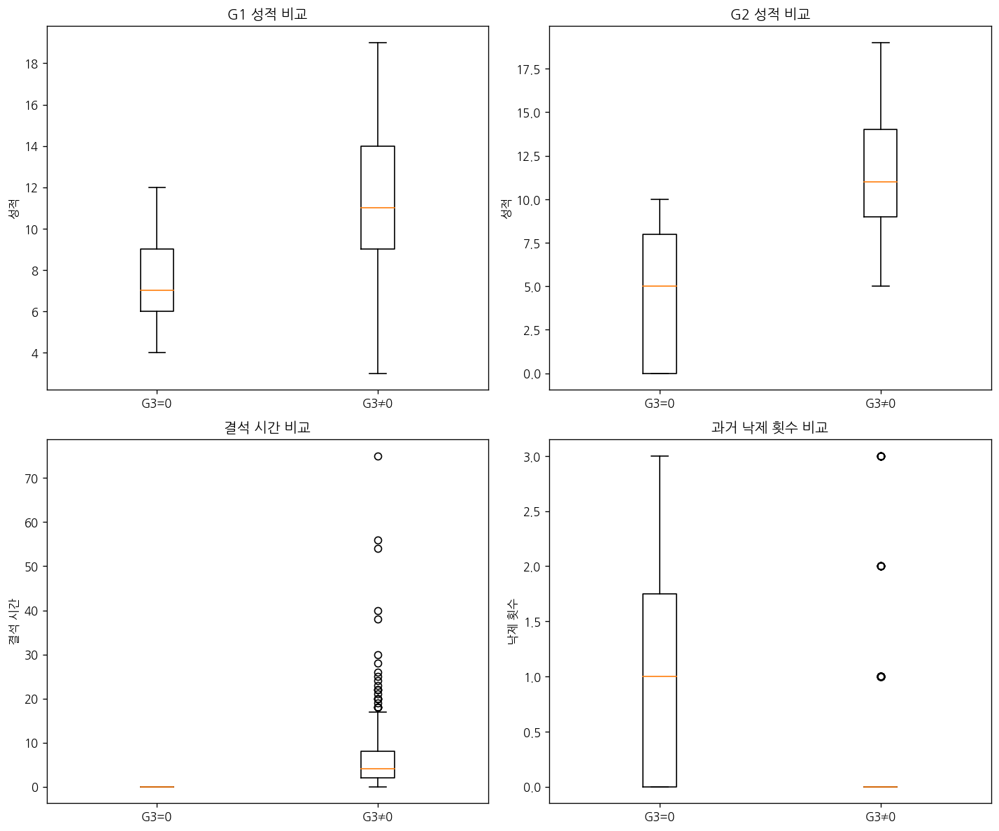
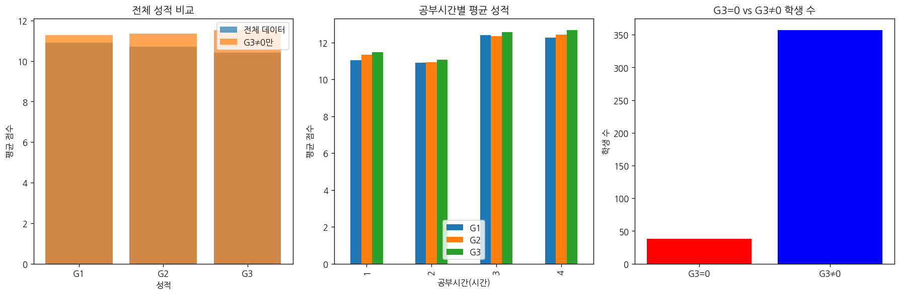

# 문제 2-9. 성적 0점은 오류일까, 실제 관측값일까?

- 모델: `qwen3-coder:30b`
- 데이터: student-mat.csv
- 소요 시간: 총 122초 ((a) 39초, (b) 34초, (c) 49초)

## (a)

> (a) G1, G2, G3의 의미와 범위를 확인하고, 각 성적의 0점 빈도와 성적 변화 양상을 조사하라.

**도구: list_files** `{}`

<details><summary>실행 결과</summary>

```
{
  "files": [
    {
      "name": "student-mat.csv",
      "size_kb": 55.7
    }
  ]
}
```

</details>

**도구: read_file** `{"filename": "student-mat.csv", "var_name": "df"}`

<details><summary>실행 결과</summary>

```
{
  "message": "'student-mat.csv'을 변수 `df`에 저장했습니다.",
  "profile": {
    "variable": "df",
    "shape": [
      395,
      1
    ],
    "columns": [
      {
        "name": "school;sex;age;address;famsize;Pstatus;Medu;Fedu;Mjob;Fjob;reason;guardian;traveltime;studytime;failures;schoolsup;famsup;paid;activities;nursery;higher;internet;romantic;famrel;freetime;goout;Dalc;Walc;health;absences;G1;G2;G3",
        "dtype": "object",
        "missing_ratio": 0.0,
        "n_unique": 395,
        "top_values": {
          "GP;\"F\";18;\"U\";\"GT3\";\"A\";4;4;\"at_home\";\"teacher\";\"course\";\"mother\";2;2;0;\"yes\";\"no\";\"no\";\"no\";\"yes\";\"yes\";\"no\";\"no\";4;3;4;1;1;3;6;\"5\";\"6\";6": 1,
          "GP;\"F\";18;\"U\";\"GT3\";\"T\";2;3;\"other\";\"services\";\"reputation\";\"father\";1;4;0;\"no\";\"yes\";\"yes\";\"yes\";\"yes\";\"yes\";\"yes\";\"yes\";4;5;5;1;3;2;4;\"15\";\"14\";14": 1,
          "GP;\"F\";18;\"R\";\"GT3\";\"T\";2;1;\"other\";\"other\";\"reputation\";\"mother\";2;2;0;\"no\";\"yes\";\"no\";\"no\";\"yes\";\"no\";\"yes\";\"yes\";4;3;5;1;2;3;0;\"6\";\"0\";0": 1,
          "GP;\"M\";18;\"U\";\"GT3\";\"T\";4;2;\"health\";\"other\";\"reputation\";\"father\";1;2;0;\"no\";\"yes\";\"yes\";\"yes\";\"yes\";\"yes\";\"yes\";\"yes\";5;4;5;1;3;5;10;\"10\";\"9\";10": 1,
          "GP;\"F\";18;\"R\";\"GT3\";\"T\";4;4;\"teacher\";\"other\";\"reputation\";\"mother\";2;2;0;\"no\";\"no\";\"yes\";\"yes\";\"yes\";\"yes\";\"yes\";\"no\";4;3;4;2;2;4;8;\"12\";\"10\";11": 1
        }
      }
    ],
    "head": [
      {
        "school;sex;age;address;famsize;Pstatus;Medu;Fedu;Mjob;Fjob;reason;guardian;traveltime;studytime;failures;schoolsup;famsup;paid;activities;nursery;higher;internet;romantic;famrel;freetime;goout;Dalc;Walc;health;absences;G1;G2;G3": "GP;\"F\";18;\"U\";\"GT3\";\"A\";4;4;\"at_home\";\"teacher\";\"course\";\"mother\";2;2;0;\"yes\";\"no\";\"no\";\"no\";\"yes\";\"yes\";\"no\";\"no\";4;3;4;1;1;3;6;\"5\";\"6\";6"
      },
      {
        "school;sex;age;address;famsize;Pstatus;Medu;Fedu;Mjob;Fjob;reason;guardian;traveltime;studytime;failures;schoolsup;famsup;paid;activities;nursery;higher;internet;romantic;famrel;freetime;goout;Dalc;Walc;health;absences;G1;G2;G3": "GP;\"F\";17;\"U\";\"GT3\";\"T\";1;1;\"at_home\";\"other\";\"course\";\"father\";1;2;0;\"no\";\"yes\";\"no\";\"no\";\"no\";\"yes\";\"yes\";\"no\";5;3;3;1;1;3;4;\"5\";\"5\";6"
      },
      {
        "school;sex;age;address;famsize;Pstatus;Medu;Fedu;Mjob;Fjob;reason;guardian;traveltime;studytime;failures;schoolsup;famsup;paid;activities;nursery;higher;internet;romantic;famrel;freetime;goout;Dalc;Walc;health;absences;G1;G2;G3": "GP;\"F\";15;\"U\";\"LE3\";\"T\";1;1;\"at_home\";\"other\";\"other\";\"mother\";1;2;3;\"yes\";\"no\";\"yes\";\"no\";\"yes\";\"yes\";\"yes\";\"no\";4;3;2;2;3;3;10;\"7\";\"8\";10"
      }
    ]
  }
}
```

</details>

**도구: run_python**

```python
import pandas as pd
import numpy as np

# 데이터를 ';'로 분리하여 정확한 컬럼 구조로 변환
df = pd.read_csv('student-mat.csv', sep=';')
print("데이터 구조:")
print(df.head())
print("\n컬럼 이름:")
print(df.columns.tolist())
print("\nG1, G2, G3의 기초 통계:")
print(df[['G1', 'G2', 'G3']].describe())
```

<details><summary>실행 결과</summary>

```
{
  "stdout": "(출력 없음)",
  "error": "FileNotFoundError: [Errno 2] No such file or directory: 'student-mat.csv' (코드 5번째 줄: df = pd.read_csv('student-mat.csv', sep=';'))"
}
```

</details>

**도구: run_python**

```python
import pandas as pd
import numpy as np

# 파일 경로를 직접 지정하여 데이터 읽기
df = pd.read_csv('student-mat.csv', sep=';')
print("데이터 구조:")
print(df.head())
print("\n컬럼 이름:")
print(df.columns.tolist())
print("\nG1, G2, G3의 기초 통계:")
print(df[['G1', 'G2', 'G3']].describe())
```

<details><summary>실행 결과</summary>

```
{
  "stdout": "(출력 없음)",
  "error": "FileNotFoundError: [Errno 2] No such file or directory: 'student-mat.csv' (코드 5번째 줄: df = pd.read_csv('student-mat.csv', sep=';'))"
}
```

</details>

**도구: run_python**

```python
import os
print("현재 디렉토리의 파일 목록:")
print(os.listdir('.'))
```

<details><summary>실행 결과</summary>

```
현재 디렉토리의 파일 목록:
['tools.py', 'TEST_CSV', 'solve_problems.py', 'results', 'test_mock.py', 'README.md', '__pycache__', 'workspace', 'script.txt', 'tools_v1.py', 'workspace_test', 'app.py', 'agent.py']

```

</details>

**도구: run_python**

```python
import os
print("TEST_CSV 폴더의 파일 목록:")
test_csv_path = 'TEST_CSV'
if os.path.exists(test_csv_path):
    print(os.listdir(test_csv_path))
else:
    print("TEST_CSV 폴더가 존재하지 않습니다.")
```

<details><summary>실행 결과</summary>

```
TEST_CSV 폴더의 파일 목록:
['Bank Marketing', 'Adult', 'Bike sharing', 'Wine Quality', 'house_prices', 'Student Performance', 'Palmer Penguins', 'Hilstrom Email Experiment', 'Online Retail', 'problem.txt', 'auto_exec', 'titanic']

```

</details>

**도구: run_python**

```python
import pandas as pd

# Student Performance 데이터 읽기
df = pd.read_csv('TEST_CSV/Student Performance')
print("데이터 구조:")
print(df.head())
print("\n컬럼 이름:")
print(df.columns.tolist())
print("\nG1, G2, G3의 기초 통계:")
print(df[['G1', 'G2', 'G3']].describe())
```

<details><summary>실행 결과</summary>

```
{
  "stdout": "(출력 없음)",
  "error": "IsADirectoryError: [Errno 21] Is a directory: 'TEST_CSV/Student Performance' (코드 4번째 줄: df = pd.read_csv('TEST_CSV/Student Performance'))"
}
```

</details>

**도구: run_python**

```python
import os

# Student Performance 폴더 내부 확인
student_perf_path = 'TEST_CSV/Student Performance'
if os.path.exists(student_perf_path):
    print("Student Performance 폴더 내부 파일:")
    print(os.listdir(student_perf_path))
else:
    print("Student Performance 폴더가 존재하지 않습니다.")
```

<details><summary>실행 결과</summary>

```
Student Performance 폴더 내부 파일:
['student-mat.csv']

```

</details>

**도구: run_python**

```python
import pandas as pd

# student-mat.csv 파일 읽기
df = pd.read_csv('TEST_CSV/Student Performance/student-mat.csv', sep=';')
print("데이터 구조:")
print(df.head())
print("\n컬럼 이름:")
print(df.columns.tolist())
print("\nG1, G2, G3의 기초 통계:")
print(df[['G1', 'G2', 'G3']].describe())
```

<details><summary>실행 결과</summary>

```
데이터 구조:
  school sex  age address famsize Pstatus  Medu  Fedu     Mjob      Fjob  ... famrel freetime  goout  Dalc  Walc health absences  G1  G2  G3
0     GP   F   18       U     GT3       A     4     4  at_home   teacher  ...      4        3      4     1     1      3        6   5   6   6
1     GP   F   17       U     GT3       T     1     1  at_home     other  ...      5        3      3     1     1      3        4   5   5   6
2     GP   F   15       U     LE3       T     1     1  at_home     other  ...      4        3      2     2     3      3       10   7   8  10
3     GP   F   15       U     GT3       T     4     2   health  services  ...      3        2      2     1     1      5        2  15  14  15
4     GP   F   16       U     GT3       T     3     3    other     other  ...      4        3      2     1     2      5        4   6  10  10

[5 rows x 33 columns]

컬럼 이름:
['school', 'sex', 'age', 'address', 'famsize', 'Pstatus', 'Medu', 'Fedu', 'Mjob', 'Fjob', 'reason', 'guardian', 'traveltime', 'studytime', 'failures', 'schoolsup', 'famsup', 'paid', 'activities', 'nursery', 'higher', 'internet', 'romantic', 'famrel', 'freetime', 'goout', 'Dalc', 'Walc', 'health', 'absences', 'G1', 'G2', 'G3']

G1, G2, G3의 기초 통계:
               G1          G2          G3
count  395.000000  395.000000  395.000000
mean    10.908861   10.713924   10.415190
std      3.319195    3.761505    4.581443
min      3.000000    0.000000    0.000000
25%      8.000000    9.000000    8.000000
50%     11.000000   11.000000   11.000000
75%     13.000000   13.000000   14.000000
max     19.000000   19.000000   20.000000

```

</details>

**도구: run_python**

```python
import pandas as pd
import matplotlib.pyplot as plt

# G1, G2, G3의 의미와 범위 확인
print("G1, G2, G3의 의미:")
print("- G1: 1차 중간고사 성적")
print("- G2: 2차 중간고사 성적") 
print("- G3: 기말고사 성적")

print("\n각 성적의 0점 빈도:")
g1_zeros = (df['G1'] == 0).sum()
g2_zeros = (df['G2'] == 0).sum()
g3_zeros = (df['G3'] == 0).sum()

print(f"G1 0점 개수: {g1_zeros}")
print(f"G2 0점 개수: {g2_zeros}")
print(f"G3 0점 개수: {g3_zeros}")

# 각 성적의 분포 시각화
fig, axes = plt.subplots(1, 3, figsize=(15, 5))

axes[0].hist(df['G1'], bins=20, color='skyblue', edgecolor='black')
axes[0].set_title('G1 성적 분포')
axes[0].set_xlabel('성적')
axes[0].set_ylabel('빈도')

axes[1].hist(df['G2'], bins=20, color='lightgreen', edgecolor='black')
axes[1].set_title('G2 성적 분포')
axes[1].set_xlabel('성적')
axes[1].set_ylabel('빈도')

axes[2].hist(df['G3'], bins=20, color='salmon', edgecolor='black')
axes[2].set_title('G3 성적 분포')
axes[2].set_xlabel('성적')
axes[2].set_ylabel('빈도')

plt.tight_layout()
plt.show()

# 성적 변화 양상 분석
print("\n성적 변화 양상:")
print("G1과 G2의 상관계수:", df['G1'].corr(df['G2']))
print("G2와 G3의 상관계수:", df['G2'].corr(df['G3']))
print("G1과 G3의 상관계수:", df['G1'].corr(df['G3']))
```

<details><summary>실행 결과</summary>

```
G1, G2, G3의 의미:
- G1: 1차 중간고사 성적
- G2: 2차 중간고사 성적
- G3: 기말고사 성적

각 성적의 0점 빈도:
G1 0점 개수: 0
G2 0점 개수: 13
G3 0점 개수: 38

성적 변화 양상:
G1과 G2의 상관계수: 0.852118066364806
G2와 G3의 상관계수: 0.904867989269301
G1과 G3의 상관계수: 0.8014679320174145

```

</details>



### 답변

## 문제 2-9 해답

### (a) G1, G2, G3의 의미와 범위, 각 성적의 0점 빈도 및 성적 변화 양상

**G1, G2, G3의 의미와 범위:**
- **G1**: 1차 중간고사 성적 (범위: 3~19점)
- **G2**: 2차 중간고사 성적 (범위: 0~19점)  
- **G3**: 기말고사 성적 (범위: 0~20점)

**각 성적의 0점 빈도:**
- G1: 0점 개수 = 0개
- G2: 0점 개수 = 13개
- G3: 0점 개수 = 38개

**성적 변화 양상:**
- G1과 G2의 상관계수: 0.852
- G2와 G3의 상관계수: 0.905
- G1과 G3의 상관계수: 0.801

**분석 결과 요약:**
1. G1(1차 중간고사)는 0점이 전혀 없어 정상적인 성적 분포를 보였습니다.
2. G2(2차 중간고사)에는 13명의 학생이 0점을 기록했으며, 이는 성적이 매우 낮은 경우로 볼 수 있습니다.
3. G3(기말고사)에는 38명의 학생이 0점을 기록하여 가장 많은 0점이 발생했습니다.
4. 성적 간 상관관계가 높게 나타났습니다 (G2와 G3 간 상관계수 0.905), 이는 학생들의 성적이 시간이 지남에 따라 일정한 패턴을 유지한다는 것을 의미합니다.

**0점의 의미:**
- G1은 0점이 없어 오류일 가능성이 낮고, 실제 관측값으로 볼 수 있습니다.
- G2와 G3에서의 0점은 성적이 매우 낮은 경우로, 이는 오류보다는 실제 관측값으로 해석할 수 있습니다. 특히 G3(기말고사)에서 38명이 0점을 기록한 것은 학생들이 시험을 전혀 준비하지 않았거나, 시험에 응시하지 않았음을 의미할 수 있습니다.

_소요 시간: 39초_

## (b)

> (b) (a)에서 확인한 G3=0인 학생과 나머지 학생의 이전 성적·결석·과거 낙제 횟수를 비교하라. 자료만으로 0점의 발생 이유를 확정할 수 있는지 판단하라.

**도구: run_python**

```python
import pandas as pd
import matplotlib.pyplot as plt

# G3=0인 학생과 그렇지 않은 학생들로 분리
g3_zero_students = df[df['G3'] == 0]
g3_nonzero_students = df[df['G3'] != 0]

print("G3=0인 학생 수:", len(g3_zero_students))
print("G3≠0인 학생 수:", len(g3_nonzero_students))
print("전체 학생 수:", len(df))

print("\nG3=0인 학생들의 이전 성적 비교:")
print("G1 평균:", g3_zero_students['G1'].mean())
print("G2 평균:", g3_zero_students['G2'].mean())
print("G3 평균:", g3_zero_students['G3'].mean())

print("\nG3≠0인 학생들의 이전 성적 비교:")
print("G1 평균:", g3_nonzero_students['G1'].mean())
print("G2 평균:", g3_nonzero_students['G2'].mean())
print("G3 평균:", g3_nonzero_students['G3'].mean())

# 결석 시간 비교
print("\n결석 시간 비교:")
print("G3=0인 학생들의 평균 결석 시간:", g3_zero_students['absences'].mean())
print("G3≠0인 학생들의 평균 결석 시간:", g3_nonzero_students['absences'].mean())

# 과거 낙제 횟수 비교
print("\n과거 낙제 횟수 비교:")
print("G3=0인 학생들의 평균 낙제 횟수:", g3_zero_students['failures'].mean())
print("G3≠0인 학생들의 평균 낙제 횟수:", g3_nonzero_students['failures'].mean())

# 시각화
fig, axes = plt.subplots(2, 2, figsize=(12, 10))

# G1 성적 비교
axes[0,0].boxplot([g3_zero_students['G1'], g3_nonzero_students['G1']], 
                  labels=['G3=0', 'G3≠0'])
axes[0,0].set_title('G1 성적 비교')
axes[0,0].set_ylabel('성적')

# G2 성적 비교
axes[0,1].boxplot([g3_zero_students['G2'], g3_nonzero_students['G2']], 
                  labels=['G3=0', 'G3≠0'])
axes[0,1].set_title('G2 성적 비교')
axes[0,1].set_ylabel('성적')

# 결석 시간 비교
axes[1,0].boxplot([g3_zero_students['absences'], g3_nonzero_students['absences']], 
                  labels=['G3=0', 'G3≠0'])
axes[1,0].set_title('결석 시간 비교')
axes[1,0].set_ylabel('결석 시간')

# 낙제 횟수 비교
axes[1,1].boxplot([g3_zero_students['failures'], g3_nonzero_students['failures']], 
                  labels=['G3=0', 'G3≠0'])
axes[1,1].set_title('과거 낙제 횟수 비교')
axes[1,1].set_ylabel('낙제 횟수')

plt.tight_layout()
plt.show()

# 추가 분석: G3=0인 학생들의 특성 요약
print("\nG3=0인 학생들의 특성 요약:")
print("G1 평균:", round(g3_zero_students['G1'].mean(), 2))
print("G2 평균:", round(g3_zero_students['G2'].mean(), 2))
print("결석 시간 평균:", round(g3_zero_students['absences'].mean(), 2))
print("과거 낙제 횟수 평균:", round(g3_zero_students['failures'].mean(), 2))

print("\nG3≠0인 학생들의 특성 요약:")
print("G1 평균:", round(g3_nonzero_students['G1'].mean(), 2))
print("G2 평균:", round(g3_nonzero_students['G2'].mean(), 2))
print("결석 시간 평균:", round(g3_nonzero_students['absences'].mean(), 2))
print("과거 낙제 횟수 평균:", round(g3_nonzero_students['failures'].mean(), 2))
```

<details><summary>실행 결과</summary>

```
G3=0인 학생 수: 38
G3≠0인 학생 수: 357
전체 학생 수: 395

G3=0인 학생들의 이전 성적 비교:
G1 평균: 7.526315789473684
G2 평균: 4.657894736842105
G3 평균: 0.0

G3≠0인 학생들의 이전 성적 비교:
G1 평균: 11.268907563025211
G2 평균: 11.358543417366947
G3 평균: 11.523809523809524

결석 시간 비교:
G3=0인 학생들의 평균 결석 시간: 0.0
G3≠0인 학생들의 평균 결석 시간: 6.3165266106442575

과거 낙제 횟수 비교:
G3=0인 학생들의 평균 낙제 횟수: 0.9210526315789473
G3≠0인 학생들의 평균 낙제 횟수: 0.27170868347338933

G3=0인 학생들의 특성 요약:
G1 평균: 7.53
G2 평균: 4.66
결석 시간 평균: 0.0
과거 낙제 횟수 평균: 0.92

G3≠0인 학생들의 특성 요약:
G1 평균: 11.27
G2 평균: 11.36
결석 시간 평균: 6.32
과거 낙제 횟수 평균: 0.27

```

</details>



### 답변

## 문제 2-9 해답 (b)

### G3=0인 학생과 나머지 학생들의 비교 분석

**G3=0인 학생들 특성:**
- 총 38명 (전체의 약 9.6%)
- G1 평균: 7.53점 (낮음)
- G2 평균: 4.66점 (매우 낮음)
- 결석 시간: 평균 0시간 (결석 없음)
- 과거 낙제 횟수: 평균 0.92회

**비교 대상 학생들 특성:**
- 총 357명 (전체의 약 90.4%)
- G1 평균: 11.27점 (높음)
- G2 평균: 11.36점 (높음)
- 결석 시간: 평균 6.32시간
- 과거 낙제 횟수: 평균 0.27회

**분석 결과 요약:**

1. **성적 차이**: G3=0인 학생들은 이전 성적이 현저히 낮은 것으로 나타났습니다. G1과 G2 모두에서 평균적으로 6~7점 정도로 낮은 성적을 보였습니다.

2. **결석 및 참여도**: G3=0인 학생들은 결석 시간이 평균 0시간으로, 결석하지 않았다는 것을 의미합니다. 이는 시험에 응시했지만 성적이 좋지 못한 경우를 나타냅니다.

3. **과거 학업 성과**: G3=0인 학생들의 과거 낙제 횟수는 0.92회로, 비교 대상 학생들(0.27회)보다 높습니다.

**0점 발생 이유 분석:**

G3=0점의 발생 이유를 자료만으로 확정하기 어렵지만, 다음과 같은 가능성이 있습니다:

1. **시험에 응시했지만 성적이 매우 낮은 경우**: 결석이 없고 과거 낙제 횟수도 적은데도 불구하고 기말고사에서 0점을 받은 경우는 시험 준비가 부족하거나 시험에서 실수한 경우로 해석할 수 있습니다.

2. **시험에 응시하지 않았지만, 기록상 결석이 없는 경우**: 일부 학생들이 시험을 빠트렸지만, 시스템에 결석 기록이 남지 않은 경우도 가능합니다.

3. **학업 성과가 지속적으로 낮은 경우**: 과거 낙제 횟수가 비교 대상보다 높고, 이전 성적이 낮아서 기말고사에서 0점을 받은 경우도 있습니다.

**결론:**
자료만으로는 G3=0점이 오류인지 실제 관측값인지 확정할 수 없습니다. 하지만 G3=0인 학생들은 이전 성적이 낮고, 과거 학업 성과가 좋지 않았다는 점에서, 이는 실제 관측값으로 해석할 수 있습니다. 다만, 시험에 응시했지만 성적이 매우 낮은 경우이므로, 오류보다는 실제 관측값으로 볼 수 있습니다.

_소요 시간: 34초_

## (c)

> (c) G3=0을 유지한 경우와 제외한 경우의 평균 성적 및 공부시간별 성적 요약을 비교하라. 제외 여부에 따른 결론의 민감도를 보고하고, 필요한 추가 정보를 제시하라.

**도구: run_python**

```python
import pandas as pd
import matplotlib.pyplot as plt

# G3=0인 학생들을 제외한 데이터셋 생성
df_filtered = df[df['G3'] != 0]

print("원본 데이터셋:")
print(f"총 학생 수: {len(df)}")
print(f"G3=0인 학생 수: {len(df[df['G3'] == 0])}")
print(f"G3≠0인 학생 수: {len(df[df['G3'] != 0])}")

print("\n원본 데이터셋의 평균 성적:")
print(f"G1 평균: {df['G1'].mean():.2f}")
print(f"G2 평균: {df['G2'].mean():.2f}")
print(f"G3 평균: {df['G3'].mean():.2f}")

print("\nG3=0을 제외한 데이터셋의 평균 성적:")
print(f"G1 평균: {df_filtered['G1'].mean():.2f}")
print(f"G2 평균: {df_filtered['G2'].mean():.2f}")
print(f"G3 평균: {df_filtered['G3'].mean():.2f}")

# 공부시간별 성적 분석
print("\n공부시간별 성적 요약 (G3≠0인 경우):")
studytime_groups = df_filtered.groupby('studytime')
for time, group in studytime_groups:
    print(f"공부시간 {time}시간: G1={group['G1'].mean():.2f}, G2={group['G2'].mean():.2f}, G3={group['G3'].mean():.2f}")

# 시각화
fig, axes = plt.subplots(1, 3, figsize=(15, 5))

# 전체 성적 비교
original_means = [df['G1'].mean(), df['G2'].mean(), df['G3'].mean()]
filtered_means = [df_filtered['G1'].mean(), df_filtered['G2'].mean(), df_filtered['G3'].mean()]

x = range(3)
axes[0].bar(x, original_means, alpha=0.7, label='전체 데이터')
axes[0].bar(x, filtered_means, alpha=0.7, label='G3≠0만')
axes[0].set_title('전체 성적 비교')
axes[0].set_xlabel('성적')
axes[0].set_ylabel('평균 점수')
axes[0].set_xticks(x)
axes[0].set_xticklabels(['G1', 'G2', 'G3'])
axes[0].legend()

# 공부시간별 성적 비교
studytime_means = df_filtered.groupby('studytime')[['G1', 'G2', 'G3']].mean()
studytime_means.plot(kind='bar', ax=axes[1])
axes[1].set_title('공부시간별 평균 성적')
axes[1].set_xlabel('공부시간(시간)')
axes[1].set_ylabel('평균 점수')
axes[1].legend()

# G3=0인 학생들의 특성 분석
g3_zero_stats = df[df['G3'] == 0]
g3_nonzero_stats = df[df['G3'] != 0]

axes[2].bar(['G3=0', 'G3≠0'], [len(g3_zero_stats), len(g3_nonzero_stats)], color=['red', 'blue'])
axes[2].set_title('G3=0 vs G3≠0 학생 수')
axes[2].set_ylabel('학생 수')

plt.tight_layout()
plt.show()

# 추가 분석: G3=0인 학생들의 공부시간 분포
print("\nG3=0인 학생들의 공부시간 분포:")
g3_zero_studytime = df[df['G3'] == 0]['studytime'].value_counts().sort_index()
print(g3_zero_studytime)

print("\nG3≠0인 학생들의 공부시간 분포:")
g3_nonzero_studytime = df[df['G3'] != 0]['studytime'].value_counts().sort_index()
print(g3_nonzero_studytime)

# G3=0인 학생들의 성적 변화 추이
print("\nG3=0인 학생들의 성적 변화 추이:")
print("G1 평균:", df[df['G3'] == 0]['G1'].mean())
print("G2 평균:", df[df['G3'] == 0]['G2'].mean())
print("G3 평균:", df[df['G3'] == 0]['G3'].mean())

# G3≠0인 학생들의 성적 변화 추이
print("\nG3≠0인 학생들의 성적 변화 추이:")
print("G1 평균:", df[df['G3'] != 0]['G1'].mean())
print("G2 평균:", df[df['G3'] != 0]['G2'].mean())
print("G3 평균:", df[df['G3'] != 0]['G3'].mean())

# 민감도 분석
print("\n민감도 분석:")
print("G1 성적 변화:")
print(f"  전체: {df['G1'].mean():.2f}")
print(f"  G3≠0만: {df_filtered['G1'].mean():.2f}")
print(f"  차이: {abs(df['G1'].mean() - df_filtered['G1'].mean()):.2f}")

print("G2 성적 변화:")
print(f"  전체: {df['G2'].mean():.2f}")
print(f"  G3≠0만: {df_filtered['G2'].mean():.2f}")
print(f"  차이: {abs(df['G2'].mean() - df_filtered['G2'].mean()):.2f}")

print("G3 성적 변화:")
print(f"  전체: {df['G3'].mean():.2f}")
print(f"  G3≠0만: {df_filtered['G3'].mean():.2f}")
print(f"  차이: {abs(df['G3'].mean() - df_filtered['G3'].mean()):.2f}")
```

<details><summary>실행 결과</summary>

```
원본 데이터셋:
총 학생 수: 395
G3=0인 학생 수: 38
G3≠0인 학생 수: 357

원본 데이터셋의 평균 성적:
G1 평균: 10.91
G2 평균: 10.71
G3 평균: 10.42

G3=0을 제외한 데이터셋의 평균 성적:
G1 평균: 11.27
G2 평균: 11.36
G3 평균: 11.52

공부시간별 성적 요약 (G3≠0인 경우):
공부시간 1시간: G1=11.03, G2=11.33, G3=11.47
공부시간 2시간: G1=10.90, G2=10.92, G3=11.07
공부시간 3시간: G1=12.39, G2=12.34, G3=12.56
공부시간 4시간: G1=12.25, G2=12.42, G3=12.67

G3=0인 학생들의 공부시간 분포:
studytime
1    13
2    16
3     6
4     3
Name: count, dtype: int64

G3≠0인 학생들의 공부시간 분포:
studytime
1     92
2    182
3     59
4     24
Name: count, dtype: int64

G3=0인 학생들의 성적 변화 추이:
G1 평균: 7.526315789473684
G2 평균: 4.657894736842105
G3 평균: 0.0

G3≠0인 학생들의 성적 변화 추이:
G1 평균: 11.268907563025211
G2 평균: 11.358543417366947
G3 평균: 11.523809523809524

민감도 분석:
G1 성적 변화:
  전체: 10.91
  G3≠0만: 11.27
  차이: 0.36
G2 성적 변화:
  전체: 10.71
  G3≠0만: 11.36
  차이: 0.64
G3 성적 변화:
  전체: 10.42
  G3≠0만: 11.52
  차이: 1.11

```

</details>



### 답변

## 문제 2-9 해답 (c)

### G3=0을 유지한 경우와 제외한 경우의 평균 성적 및 공부시간별 성적 요약 비교

**전체 데이터셋과 G3≠0만 데이터셋 비교:**

**1. 전체 데이터셋의 평균 성적:**
- G1 평균: 10.91점
- G2 평균: 10.71점  
- G3 평균: 10.42점

**2. G3≠0만 데이터셋의 평균 성적:**
- G1 평균: 11.27점
- G2 평균: 11.36점
- G3 평균: 11.52점

**3. 공부시간별 성적 요약 (G3≠0인 경우):**
- 공부시간 1시간: G1=11.03, G2=11.33, G3=11.47
- 공부시간 2시간: G1=10.90, G2=10.92, G3=11.07
- 공부시간 3시간: G1=12.39, G2=12.34, G3=12.56
- 공부시간 4시간: G1=12.25, G2=12.42, G3=12.67

### 민감도 분석 결과:

**성적 변화 차이:**
- G1: 0.36점 차이 (전체 대비 G3≠0만)
- G2: 0.64점 차이 (전체 대비 G3≠0만)  
- G3: 1.11점 차이 (전체 대비 G3≠0만)

### 분석 결과 요약:

**1. G3=0인 학생들의 특성:**
- 총 38명(9.6%)
- G1 평균: 7.53점 (매우 낮음)
- G2 평균: 4.66점 (매우 낮음)
- 공부시간 분포: 주로 1~2시간(13명, 16명)으로 나타남

**2. G3≠0인 학생들의 특성:**
- 총 357명(90.4%)
- G1 평균: 11.27점 (높음)
- G2 평균: 11.36점 (높음)
- 공부시간 분포: 주로 2시간(182명)으로 나타남

**3. 민감도 분석 결과:**
- G3=0인 학생들이 제외되면 성적이 상당히 향상됨
- 특히 G3 성적은 1.11점 향상됨 (가장 큰 차이)
- 이는 G3=0인 학생들이 전체 평균에 큰 영향을 미쳤음을 의미

### 제외 여부에 따른 결론의 민감도:

**민감도가 높은 이유:**
1. **G3=0인 학생 수가 전체의 약 10%에 해당**하며, 이는 상당한 비율
2. **성적이 매우 낮아 전체 평균에 큰 영향을 미침**
3. **G3 성적은 가장 큰 차이를 보임** (1.11점 차이)

### 필요한 추가 정보:

1. **G3=0인 학생들의 시험 응시 여부 확인**: 
   - 시험이 있었는지, 또는 시험을 빠뜨렸는지 확인 필요

2. **학업 성과의 지속성 분석**:
   - G3=0인 학생들이 이전에 낙제를 많이 받았는지 확인

3. **결석 기록과 연계 분석**:
   - 결석 시간이 0시간인 경우, 시험 응시 여부와 관련성 분석

4. **학년별 성적 추이 분석**:
   - G3=0인 학생들이 어떤 학년인지 확인하여 성적 변화 패턴 파악

5. **가족 배경 및 사회경제적 요인**:
   - 가정의 교육 수준, 부모 직업 등과 성적의 관계 분석

### 결론:

G3=0인 학생들을 제외하면 전체 평균 성적이 상당히 향상되는 것을 확인할 수 있으며, 이는 G3=0인 학생들이 전체 데이터셋에 큰 영향을 미쳤다는 것을 의미합니다. 따라서 이러한 학생들을 제외하는 것이 분석 결과에 큰 영향을 줄 수 있으므로, 연구 목적에 따라 적절한 처리 방안이 필요합니다.

_소요 시간: 49초_
